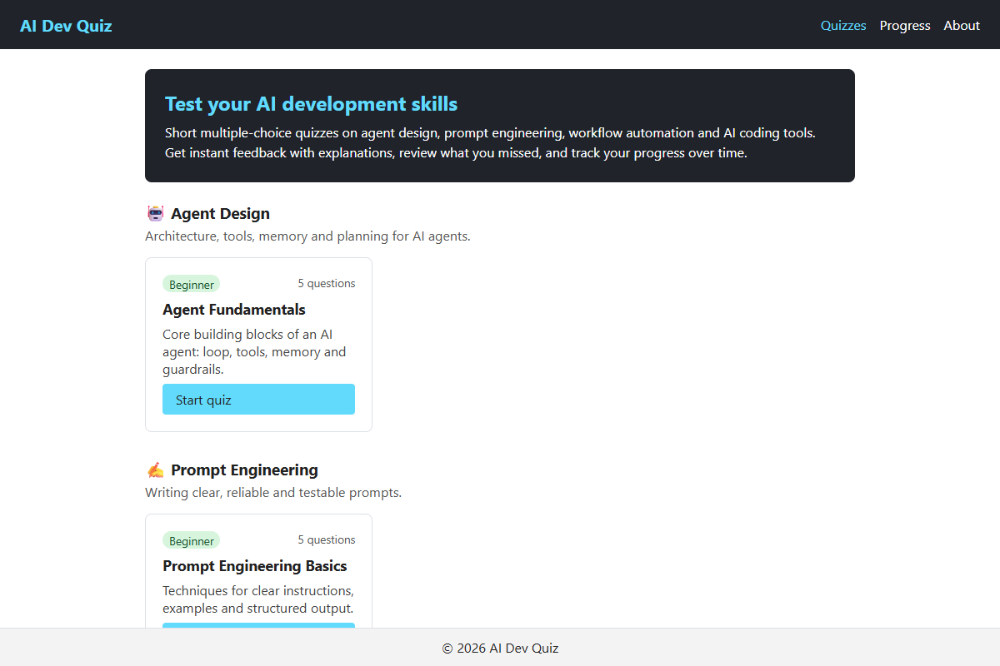
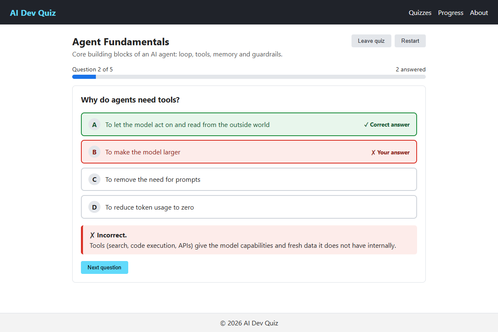
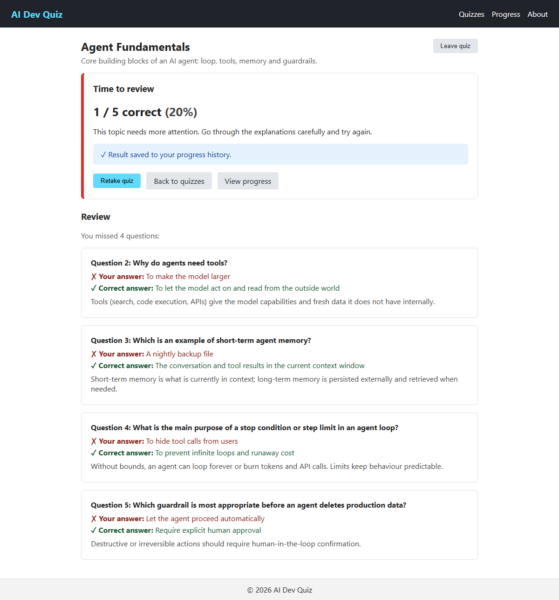
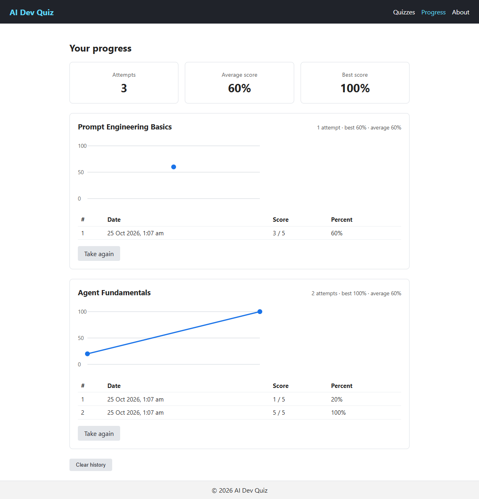
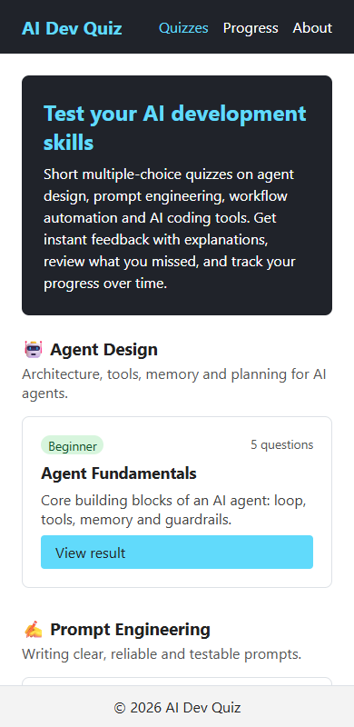
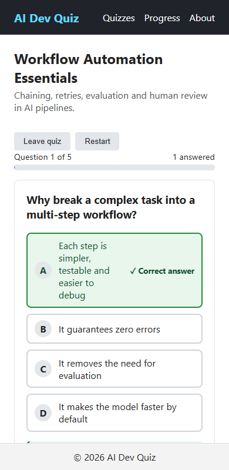
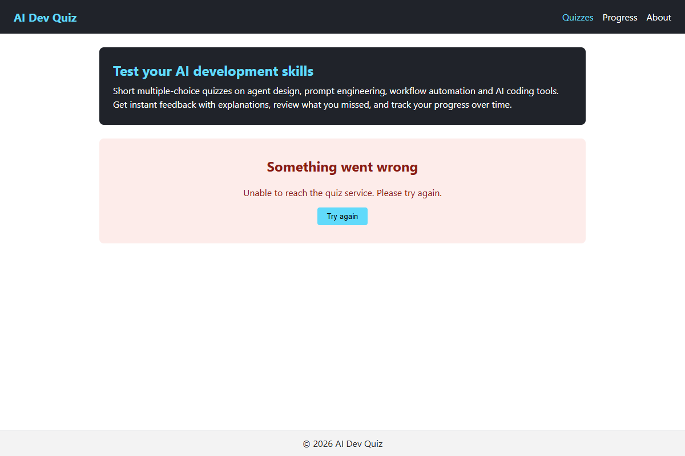

# AI Dev Quiz

A multiple-choice quiz app for learning AI software development. Take a quiz, get instant feedback with explanations, review what you missed, and track your scores over time. Built with Vite, React 18 and React Router 6. There is no backend: a mock API serves the data and `localStorage` persists progress.

## Screenshots

| Home – quiz catalogue | Question with instant feedback |
| --- | --- |
|  |  |

| Results and review of missed questions | Progress history and score trend |
| --- | --- |
|  |  |

| Mobile – catalogue | Mobile – quiz | Error state with retry |
| --- | --- | --- |
|  |  |  |

## Features

- **Quiz catalogue** – four quizzes grouped by category (Agent Design, Prompt Engineering, Workflow Automation, AI Coding Tools), each with a difficulty badge and question count.
- **Guided quiz flow** – one question at a time, answers lock once chosen, and an explicit *Next question* / *Finish quiz* button advances. Questions cannot be skipped.
- **Instant feedback** – correct/incorrect is shown with ✓/✗ symbols and text (not colour alone), plus an explanation.
- **Results** – score, percentage, a performance message that varies by tier, and a review of missed questions (your answer vs the correct one).
- **Resume after refresh** – in-progress attempts are saved after every answer and restored on reload; quiz cards show *Resume quiz* / *View result*. You can also restart (with confirmation).
- **Retake and history** – every completed attempt is saved exactly once and listed on the **Progress** page with overall stats, a per-quiz table and an SVG score-trend chart. History can be cleared (with confirmation).
- **Robust states** – loading, empty, error and retry views on every data-driven page; clear notices when saving fails, saved data is damaged, or storage is unavailable.
- **Data validation** – quiz data is validated (required fields, at least 5 questions, 2+ unique options, valid `correctOptionId`) before a quiz starts; persisted attempts and history records are validated when read.
- **Accessibility and layout** – keyboard-operable controls with visible focus, ARIA roles/live regions, accessible dialogs (Esc to close), responsive layout, and a sticky header and footer so navigation stays visible while content scrolls.

## Getting started

Requirements: Node.js 18+ and npm.

```
npm install
npm run dev       # start the dev server (http://localhost:5173)
```

| Script | Purpose |
| --- | --- |
| `npm run dev` | Start the Vite dev server |
| `npm run build` | Production build into `dist/` |
| `npm run preview` | Serve the production build locally |
| `npm test` | Run all tests once (Vitest) |
| `npm run test:watch` | Re-run tests on change |

## Routes

| Path | Page |
| --- | --- |
| `/` | Quiz catalogue (Home) |
| `/quiz/:quizId` | Take a quiz / see results |
| `/progress` | Attempt history and charts |
| `/about` | About |
| `*` | 404 page |

## Project structure

```
docs/
  screenshots/  images used in this README
src/
  components/   UI pieces: AsyncState, Button, ConfirmDialog, Header, Footer,
                ProgressBar, ProgressChart, QuestionCard, QuizCard, QuizResult
  data/         mock quiz data (quizData.js, with DATA_VERSION)
  hooks/        useAsync (loading/empty/error/retry), useQuizAttempt (attempt state + persistence)
  layouts/      MainLayout (sticky header, content, sticky footer)
  pages/        Home, QuizPage, Progress, About, NotFound
  routes/       router configuration
  services/     quizApi.js – mock API with simulated latency
  styles/       global.css
  test/         test setup and fixtures
  utils/        quizSchema (validation + scoring), storage (localStorage), results (messages, review)
```

## How it works

- **Attempt state** lives in a pure reducer (`attemptReducer` in `useQuizAttempt.js`). Each action names the question/index it targets, so duplicate, stale or rapid clicks are ignored: no double-counting and no skipped questions.
- **Score is always recomputed** from the recorded answers (`calculateScore`), never from a click counter.
- **History saving is idempotent** per `attemptId`, so re-renders, StrictMode and refreshes cannot create duplicates.
- **Mock API** (`services/quizApi.js`) mirrors `GET /categories`, `GET /quizzes` and `GET /quizzes/:id`. List responses omit questions; the full quiz is validated before it reaches the UI.
- **Bumping data**: change `DATA_VERSION` in `data/quizData.js` whenever question content changes, so saved attempts made against older content are discarded.

### localStorage keys

| Key | Content |
| --- | --- |
| `quizapp:activeAttempt` | In-progress attempts, keyed by quiz id |
| `quizapp:history` | Completed attempts (list) |
| `quizapp:history:corrupt-backup` | Backup of unreadable history, kept before it is replaced |
| `quizapp:mock` | Dev switch for the mock API (see below) |

## Testing

```
npm test
```

Vitest + Testing Library (jsdom). Tests sit beside the code (`*.test.js` / `*.test.jsx`); shared builders are in `src/test/fixtures.js`.

- Logic: schema validation, scoring, storage, results helpers, mock API, quiz data.
- Hooks: `useAsync` (stale responses, retry), `useQuizAttempt` (rapid clicks, resume, completion, retake, save failure).
- Components and pages: every component, plus `src/App.test.jsx` for full flows (complete a quiz and verify score/percentage, resume after refresh, retake and history, empty/error/retry, invalid persisted data).

### Manual testing helpers

In the browser console:

```js
localStorage.setItem('quizapp:mock', 'error'); // API calls fail -> error + retry UI
localStorage.setItem('quizapp:mock', 'empty'); // API returns no quizzes -> empty state
localStorage.removeItem('quizapp:mock');       // back to normal
```

Suggested manual checks: finish a quiz and verify score and percentage; click answers and Next rapidly; refresh mid-quiz and after finishing; retake and confirm two history entries; put invalid JSON in `quizapp:history` or `quizapp:activeAttempt`.

## AI interaction log

`.chat-history/log.md` records the AI-assistant interactions for this project (see `.github/copilot-instructions.md`). Keep it in the project root when packaging.

## Packaging

Zip the project without `node_modules`, `dist`, `build`, `vendor`, `venv` or `.git`, and confirm `.chat-history/log.md` is at the archive root and non-empty.
